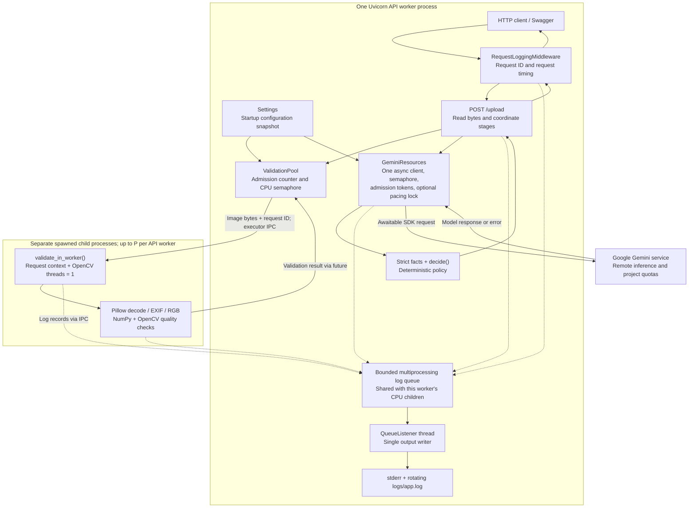

# Image Analysis API Architecture

Reference for system design interviews and for APIs that combine CPU-intensive work with network-intensive work.


## Contents

1. [System overview](#1-system-overview)
2. [Architecture and process boundaries](#2-architecture-and-process-boundaries)
3. [Module reference](#3-module-reference)
4. [Startup, configuration, and shutdown](#4-startup-configuration-and-shutdown)
5. [Request sequences](#5-request-sequences)
6. [Scaling mechanisms](#6-scaling-mechanisms)
7. [Worker multiplication and capacity planning](#7-worker-multiplication-and-capacity-planning)
8. [Resource costs and remaining bottlenecks](#8-resource-costs-and-remaining-bottlenecks)
9. [Tests and performance evidence](#9-tests-and-performance-evidence)
10. [Confirmed evolution and removals](#10-confirmed-evolution-and-removals)
11. [Proposed simplifications and future improvements](#11-proposed-simplifications-and-future-improvements)
12. [Interview reference](#12-interview-reference)

## 1. System overview

The API checks whether a product image meets local quality rules, asks Gemini for structured visual facts, and applies deterministic acceptance rules in Python.

```text
POST /upload, multipart field "file"
  -> read image bytes
  -> bounded CPU validation
  -> if locally valid: bounded async Gemini analysis
  -> strict fact validation
  -> deterministic business decision
  -> JSON response
```

The HTTP request remains open until processing finishes. Async execution allows other requests to progress during waits; there is no durable job submission, result database, or background-job status endpoint.

### Separation of responsibilities

| Work | Execution location | Reason for this choice |
| --- | --- | --- |
| HTTP handling, admission, deadlines | API process/event loop | Coordinate concurrent requests and asynchronous waits |
| Decode, orientation, resolution, blur score | Spawned validation process | Keep synchronous image work away from the API event loop |
| Gemini inference request | Async SDK client in API process; inference runs remotely | Overlap network waits without dedicating a local CPU worker to each call |
| Schema parsing and business decision | API process | Small synchronous operations; policy remains explicit and testable |
| JSON formatting and console/file output | Logging listener thread in API process | Keep normal output I/O away from request execution |


## Architecture and process boundaries



Solid arrows represent work/results; dotted arrows represent logging. The diagram shows one API worker, not a fleet-wide shared queue or client. Other Uvicorn workers create their own copies. The process-pool object is constructed at startup; child processes can start on initial submissions, so warm workers are not guaranteed before the first upload.

##  Module reference

| Module | Responsibility and key choices | Main collaborators |
| --- | --- | --- |
| [main.py](main.py) | Routes, `decide()`, one application lifespan, HTTP error mapping, upload cleanup. Stores resources on `app.state`; wraps the complete FastAPI app in logging middleware. | Settings, validation pool, Gemini resources, schemas, logging |
| [settings.py](settings.py) | Frozen Pydantic settings; numeric bounds/finite floats; CPU-dependent worker default; secret key representation. `from_env()` reads `.env`, then overlays process environment without mutating it. | Lifespan and Gemini resources |
| [validation_pool.py](validation_pool.py) | Required caller-supplied `log_queue`; spawned executor; admission counter; CPU semaphore; queue timeout; shielded future and completion callback. Owns executor only. | Local validator, logging queue, route |
| [validate_image.py](validate_image.py) | Synchronous image decoding, EXIF orientation, RGB conversion, size and sharpness checks. Returns scores/reasons and emits stage logs. | Pillow, NumPy, OpenCV, schemas via route |
| [gemini_resources.py](gemini_resources.py) | One `GeminiResources` class plus one lifecycle context manager. Owns client creation/closure and shared admission, semaphore, pacing state; exposes `analyze()`. | Settings, SDK, analysis function, route |
| [analyse_image.py](analyse_image.py) | Prompt, provider call, strict parsing, queue/attempt/total deadlines, `is_retryable_error()`, jitter/`Retry-After`, RPM spacing, review fallback. | Gemini resources, SDK/httpx, schemas, logging |
| [schemas.py](schemas.py) | `ProductAnalysis`, `ImageScores`, `UploadResponse`. Required fact fields, forbidden extras, placement enum, bounded confidence; analysis parses facts strictly. | Analysis, local checks via response, business policy |
| [request_logging.py](request_logging.py) | Request-ID context/middleware; approved JSON fields; exception preparation; bounded queue handler; listener and rotating output; startup/shutdown functions. Silent queue overflow. | Lifespan, routes, analysis, CPU workers |
| [tests/](tests/) | Generated images, mocked provider, controlled executor futures, route/lifecycle tests, plus a real spawned-process logging check. | All application modules |

Configuration and tooling: [.env_example](.env_example) lists environment knobs; [requirements.txt](requirements.txt) pins direct dependencies; [requirements-dev.txt](requirements-dev.txt) adds test tooling; [pytest.ini](pytest.ini) sets discovery/import paths. [README.md](README.md) provides quick setup and usage.

##  Startup, configuration, and shutdown

### Resource ownership

```text
lifespan():
  Read/validate Settings once
  Start application logging
  Create ValidationPool with the application's queue
  gemini_resources():
    Create SDK owner and async client; create GeminiResources
    yield -> application serves requests
    Close async client; attempt synchronous owner closure off-loop
  Close validation executor off-loop, waiting for running work
  Drain/stop listener off-loop; close output handlers and queue
```

`yield` marks the period during which the application can serve requests; it is not called once per upload. Logging outlives the worker producers so their final records can drain. `Settings` owns numeric configuration validation; `ValidationPool` assumes its caller supplies validated worker counts, waiting capacity, and timeout values. Direct callers must use `Settings` or provide equivalent validation.

One `lifespan()` now owns application resource wiring. Its nested `try/finally` blocks keep logging alive until the pool closes and still stop logging if pool creation or shutdown fails.

- Invalid settings fail before logging or executors are allocated.
- Executor construction failure reaches the outer lifespan, which stops application logging.
- Gemini client initialisation failure is caught and logged; resources can be created with `client=None`, allowing `/health` and local validation. Locally valid uploads then become `needs_review`.
- Errors constructing `GeminiResources` itself propagate, while the client-cleanup `finally` still runs and the outer scope closes the validation pool.
- Cleanup tries both SDK transports and logs ordinary cleanup exceptions. Graceful shutdown is not a crash-recovery protocol; running CPU work and blocked log output have no application hard shutdown deadline.


##  Request sequences

These diagrams describe application tasks and resources. A task cancellation is not assumed to be an automatically detected browser disconnect. Logging is omitted from the sequence arrows to keep the work boundaries visible.

###  Successful processing and local rejection

```mermaid
sequenceDiagram
    participant C as Client
    participant A as API task
    participant V as ValidationPool
    participant W as CPU child process
    participant G as GeminiResources / analysis
    participant P as Gemini service
    C->>A: POST /upload with file
    A->>A: Request ID, multipart parsing, read bytes
    A->>V: validate(bytes, request_id)
    V->>V: Reserve admission; acquire CPU slot
    V->>W: Submit bytes and request ID
    W->>W: Decode, orient, calculate quality
    W-->>V: Validation result
    V->>V: Completion callback releases CPU capacity
    V-->>A: Scores and local verdict
    alt Local quality fails
        A->>A: Close uploaded file in finally
        A-->>C: 200 fail; facts null; Gemini skipped
    else Local quality passes
        A->>G: analyze(bytes, MIME)
        G->>G: Admit, acquire analysis slot, optional pace
        G->>P: Await generate_content
        P-->>G: Structured response
        G->>G: Strictly validate ProductAnalysis
        G->>G: Release analysis slot and admission
        G-->>A: Validated facts
        A->>A: Apply ordered business rules
        A->>A: Close uploaded file in finally
        A-->>C: 200 pass / fail / needs_review
    end
```

JSON parsing and `decide()` are synchronous in the API process; they are expected to be small, not proven to be zero-cost.

###  Overload and waiting deadlines

```mermaid
sequenceDiagram
    participant C as Client
    participant A as API task
    participant V as ValidationPool
    participant G as Gemini admission
    C->>A: Upload; bytes read before validation admission
    A->>V: validate
    alt Validation capacity full or pool closing
        V-->>A: ValidationBusy immediately
        A-->>C: 503 and Retry-After 1
    else Validation admitted but no CPU slot in time
        V->>V: Wait up to VALIDATION_WAIT_TIMEOUT
        V->>V: Release admission; no job submitted
        V-->>A: ValidationBusy
        A-->>C: 503 and Retry-After 1
    else Validation succeeds
        V-->>A: Local pass and scores
        A->>G: Reserve analysis admission
        alt Analysis admission full
            G-->>A: GeminiBusy; no provider attempt
            A-->>C: 503 and Retry-After 1
        else Analysis admitted but semaphore wait expires
            G->>G: Release admission token
            G-->>A: GeminiBusy; no provider attempt
            A-->>C: 503 and Retry-After 1
        end
    end
    Note over A,G: Retry-After is guidance, not a recovery guarantee
```

Validation may finish and consume CPU even when the later Gemini stage is full. There is no pipeline-wide admission reservation. A broken executor also maps to 503, but is unavailable capacity rather than healthy queue saturation; automatic pool rebuilding is not implemented.

###  Analysis timeout and retry

```mermaid
sequenceDiagram
    participant C as Client
    participant A as API task
    participant G as Gemini analysis
    participant P as Gemini service
    A->>G: Analyze locally valid image
    G->>G: Admit; start total deadline; wait for slot
    alt Deadline expires before any attempt
        G->>G: Release locally acquired capacity
        G-->>A: GeminiBusy
        A-->>C: 503 and Retry-After 1
    else Provider attempt begins
        G->>P: Attempt 1 under attempt timeout
        alt First attempt times out and retry budget remains
            G->>G: Classify as retryable; backoff plus jitter
            G->>G: Optional RPM pacing; total timer still running
            G->>P: Attempt 2 if remaining time permits
            alt Second attempt returns valid facts
                P-->>G: Facts
                G->>G: Validate and release local capacity
                G-->>A: Facts
                A-->>C: 200 business decision
            else Attempt 2 fails or total deadline expires
                G->>G: Release local capacity
                G-->>A: None
                A-->>C: 200 needs_review with llm_error
            end
        else Total deadline expires after a call started
            G->>G: Cancel local await; release local capacity
            G-->>A: None
            A-->>C: 200 needs_review with llm_error
        end
    end
    Note over G,P: Local timeout does not prove remote work stopped
```

This diagram illustrates timeout paths, not every successful/error combination. `attempted` remains true once the first call starts: a total deadline during later retry backoff/pacing therefore gives review fallback, not pre-call 503. Timing out a running CPU validation is not part of this analysis deadline.

###  Cancellation at different stages

```mermaid
sequenceDiagram
    participant K as Task cancellation source
    participant A as API task
    participant V as ValidationPool
    participant W as CPU child process
    participant G as Gemini analysis
    participant P as Gemini service
    alt Cancelled while waiting for CPU slot
        A->>V: Admitted validation waiting for semaphore
        K-->>A: Cancel task
        V->>V: Release admission; no CPU submission
        V-->>A: CancelledError propagates
    else Cancelled after CPU submission
        A->>V: validate
        V->>W: Submit validation
        K-->>A: Cancel task
        V-->>A: Shield preserves future; cancellation propagates
        Note over V,W: Slot and admission stay reserved
        W-->>V: Future completes later
        V->>V: Callback releases capacity; consumes exception if any
    else Cancelled during Gemini waiting or active call
        A->>G: Analyze
        opt Provider request already sent
            G->>P: generate_content
        end
        K-->>A: Cancel task
        G->>G: Unwind semaphore and admission finally
        G-->>A: CancelledError propagates
        Note over G,P: Remote work may continue after local cancellation
    end
    A->>A: Route finally attempts file cleanup
    Note over A: No application-specific cancellation HTTP response
```

Tests explicitly cancel tasks. The route does not monitor `request.is_disconnected()` or implement a client-disconnect watcher. Normal task cancellation propagates because `CancelledError` is not swallowed by `except Exception`. There is no dedicated 499 response or cancellation outcome metric in this application.

##  Scaling mechanisms

### 6.1 CPU execution and admission

| Mechanism | Problem solved | Implementation / scope | Limitation or tradeoff |
| --- | --- | --- | --- |
| Spawned process pool | Synchronous image work would occupy the API event-loop thread | One executor per API worker; `run_in_executor()` transfers bytes/ID and returns a future | Extra processes, imports, IPC/copying, startup cost; speedup over threads is unmeasured |
| CPU semaphore | Too much submitted work competing for CPU | `P` local slots acquired before executor submission | Caps submissions holding slots, not all HTTP requests or incoming bytes |
| Admission counter | Semaphore waiters otherwise grow without a count bound | `_admitted <= P + V`; check/increment has no intervening await on the same event loop | Local event-loop assumption; not a cross-thread/process counter or memory-byte budget |
| Validation wait timeout | Requests wait indefinitely for a CPU slot | `wait_for(semaphore.acquire(), wait_timeout)` | Does not include image transfer, process startup after submission, or execution time |
| Shield and done callback | Cancelling an awaiting task could falsely free still-busy capacity | `shield(future)`; `_finished()` releases slot/admission and consumes a detached failure | CPU work continues after cancellation and can occupy a slot indefinitely if stuck |
| One OpenCV thread per child | Nested parallelism can multiply native CPU threads | Worker initializer calls `cv2.setNumThreads(1)` | Does not control every native library/helper thread or account for container CPU allocation |

Only successfully acquired slots reach the executor, so the application does not deliberately submit the entire admitted backlog into the executor's internal queue. Waiting images live in request coroutines in the API process. The slot stays occupied until the submitted future completes, even if the caller stopped awaiting it.

The CPU work is a mix of Pillow decoding and native NumPy/OpenCV operations. Processes are a defensible isolation choice; a bounded thread implementation remains a useful comparison because some native operations can release the GIL. 

###  Network execution, budgets, and retries

| Mechanism | Problem solved | Implementation / scope | Limitation or tradeoff |
| --- | --- | --- | --- |
| Async SDK call | Network waiting must not occupy the API event loop or CPU worker | `await client.models.generate_content(...)` in the API process | Remote inference time remains; synchronous parsing/SDK preparation can still consume local CPU |
| Shared client | Per-request client creation loses transport reuse and complicates ownership | One owner/async client per API worker, closed by one context manager | Does not share connections across processes; connection-pool sizes/acquisition limits are not explicitly tuned here |
| Analysis admission | Bound active plus waiting analyses | `asyncio.Queue(maxsize=G + H)` used as tokens via `put_nowait()`/`get_nowait()` | No consumer worker or durable payload queue; overflow rejects after local validation already ran |
| Analysis semaphore | Limit simultaneous analyses using provider capacity | `G` slots shared across requests in one API worker | Slot covers pacing, both attempts, backoff, and parsing, not only in-flight network time |
| RPM pacing | Concurrency alone does not control attempt frequency | Positive `R` uses a shared lock, monotonic next-start time, async sleep; retries also pace | Disabled by default; local smooth spacing, not authoritative provider RPM/TPM/daily quota enforcement |
| Queue, attempt, total timers | Distinguish slot waiting, one attempt, and total analysis time | Nested `asyncio.timeout()` scopes; queue timer disabled once the semaphore is acquired | No whole-upload deadline; cancellation is cooperative, and synchronous work is not preempted instantly |
| Retry classification | Make transient-error policy explicit | `is_retryable_error()`: timeout, httpx transport error, or API status 408/429/500/502/503/504 | Not all failures are transient in practice; maximum two application attempts, not guaranteed recovery |
| Backoff plus jitter | Avoid immediate synchronized retries | Base + uniform jitter; honours a longer valid numeric/date `Retry-After`; total timer remains active | With only one retry there is no multi-step exponential schedule; retries add latency, quota, and possible cost |
| Cancellation cleanup | Avoid leaking local analysis reservations | Semaphore context and `finally` release local admission; cancellation propagates | Cannot prove a remote request stopped or prevent all remote overlap after timeout/retry |

SDK retry options specify one attempt, leaving the bounded application policy in control. Authentication/validation API errors outside the allowlist and invalid structured output are not retried. The helper's use of `httpx.TransportError` is the implemented category; it is not a guarantee that every SDK exception has that type.

Example with defaults and no longer provider advice:

```text
wait up to 3 s for an analysis slot
  -> attempt 1: up to 10 s
  -> retry delay: 0.5–1.0 s
  -> optional RPM wait
  -> attempt 2: up to 10 s
all subject to a 30 s analysis-stage deadline
```

This is a control-flow example, not a p99 bound. The earlier upload and validation time are additional. Longer `Retry-After` or pacing can consume the remaining total budget; no special retry is guaranteed a fresh full 10 seconds beyond the total deadline.

`attempted` distinguishes availability from a failed analysis: before the first attempt, deadline expiry raises `GeminiBusy`; after an attempt, ordinary errors return `None` for the review decision. A missing client returns `None` before acquiring analysis admission.

### Logging and observability

| Mechanism | Problem solved | Scope | Limitation |
| --- | --- | --- | --- |
| Request IDs and context | Connect events across asynchronous requests and CPU workers | Validated header or generated UUID; context variable in API; explicitly set/reset in child | Correlation only; not distributed tracing or a unique business-operation/idempotency key |
| Structured stage logs | Separate waiting, work, provider attempts, and business results | JSON field allowlist; request and stage duration events | Logs need analysis to produce aggregate latency/error/queue metrics; no metrics endpoint/dashboard exists |
| Queue handler/listener | Slow console/disk should not hold request execution | Bounded multiprocessing queue shared by API and its CPU children; output listener thread | Record creation, synchronization, message/traceback preparation still cost CPU; logging is not cost-free |
| Silent overflow drops | Preserve responsiveness and bounded queued records | New records, including errors, dropped on full queue | No counter or periodic/final loss report; failures may lack logs under overload |
| Rotation and graceful drain | Bound disk retention and flush accepted records on normal exit | Active 5 MiB file plus 3 backups; listener is the writer; blocking sentinel insertion only during off-loop shutdown | Not durable auditing; abrupt death loses queued records; stalled sinks can delay shutdown |

`LogQueueHandler.prepare()` copies the record and formats traceback text before the process boundary so exceptions stay serializable and appear as a separate JSON field. `LogQueueListener` retains only the shutdown-sentinel override: a full queue must not make normal listener shutdown fail through `put_nowait()`.

Middleware wraps the complete application, adds `X-Request-ID` to response headers, and records its ASGI execution interval. Client-side transfer/connection latency can differ. It logs unexpected exceptions with tracebacks; provider-error paths omit raw provider text/output/images. Business outcomes and transport outcomes remain separate: HTTP 200 with `llm_error` needs attention even when an HTTP-only dashboard looks healthy.

There is no dedicated cancellation log outcome. Before a response starts, the middleware's initial status value is 500; do not interpret every logged status during task cancellation as proof that an HTTP 500 reached a client.

##  Worker multiplication and capacity planning

Let:

```text
U = Uvicorn API worker processes per replica
K = replica count
N = U × K
P = validation workers per API process
V = extra admitted validations per API process
G = concurrent analysis slots per API process
H = extra admitted analyses per API process
R = configured local RPM pacing, when positive
L = log queue capacity per API process
```

Each API worker independently runs lifespan and owns the following resources:

| Resource | Per API worker | Fleet, assuming identical configuration |
| --- | --- | --- |
| Validation child-process ceiling | `P` | `N × P` |
| Admitted validation jobs | `P + V` | `N × (P + V)` |
| Analysis slots | `G` | `N × G` |
| Admitted analyses | `G + H` | `N × (G + H)` |
| Async Gemini client owners | 1 | `N` |
| Log listener threads | 1 | `N` |
| Queued log records | `L` | `N × L`, split among independent queues |
| Positive-RPM attempt-start spacing | Approx. `R/min` over time | Nominally `N × R/min`; not a coordinated fleet quota |

`R=0` disables pacing; it does not mean zero requests. A client/protocol can still have additional limits internally. Local cancellations/timeouts may release slots before remote processing ends, so `N × G` is not a strict upper bound on all unfinished work inside the provider.

### Default example: one versus four API workers

Assume at least four reported CPUs, one replica, and default settings:

| Resource | 1 API worker | 4 API workers |
| --- | --- | --- |
| Validation child processes, up to | 4 | 16 |
| Validation admission | 100 | 400 across 4 independent gates |
| Analysis slots | 5 | 20 |
| Analysis admission | 25 | 100 across 4 independent gates |
| Log queue records | 1000 | 4000 across 4 queues |
| Local RPM pacing | Disabled | Disabled in all 4 |
| If each process instead sets RPM=60 | Nominal 60/min | Nominal 240/min across independent pacers |

Four API workers plus up to 16 validation children means up to 20 API/validation processes, excluding Uvicorn supervision and implementation-specific helper processes. Logging threads and executor/queue helper threads are additional. Do not size by API worker count alone.

These counts are stage capacities, not an end-to-end HTTP request cap. Uploads can be parsing/reading before admission, and different requests occupy different stages. A CPU slot is released before that request acquires Gemini capacity.

**Before enabling multiple API workers, fix the log destination.** Every worker currently constructs a rotating handler for the same `logs/app.log`; there is no cross-process rotation coordination. Shared provider quota also requires a deliberate fleet strategy.

After those changes, a multi-worker invocation would omit development reload:

```powershell
.\.venv\Scripts\python.exe -m uvicorn main:app --workers 4 --no-access-log
```

### Throughput estimates versus useful completions

Assume every upload passes local validation, CPU work averages 50 ms, provider occupied time averages 2 s, and shared quota permits 120 attempts/min:

```text
CPU estimate:       4 / 0.05 s = 80 validations/s
Analysis estimate:  5 / 2 s    = 2.5 analyses/s
Quota estimate:     120 / 60   = 2 provider attempts/s
```

The provider quota is the tighter ceiling in this example. Retry attempts reduce useful completions per quota unit; pacing/backoff occupying slots can reduce analysis throughput. Adding validation processes does not change that provider budget.

If only a fraction of uploads reaches Gemini, multiply arrival rate by that fraction to estimate downstream demand. Account for payload/service-time variance and queue delay. Little's Law (`average in-flight = throughput × average time in system`) is a stable-average consistency check, not a percentile guarantee. No repository benchmark establishes any of the illustrative rates above.

##  Resource costs and remaining bottlenecks

| Resource / boundary | Current concern | What to measure or change next |
| --- | --- | --- |
| Upload memory | Route reads all bytes before validation admission; framework multipart buffering can occur earlier | Early incoming request/byte bounds; actual concurrent retained bytes |
| Decoded image memory | RGB, NumPy conversion, grayscale, float64 Laplacian, temporary arrays, and IPC can coexist | Peak RSS per image size and worker; application pixel/format limits |
| CPU | `os.cpu_count()` default is not a fleet-wide/container-budget allocator; more API workers multiply child pools | Effective allocated CPU, process contention, queue wait, and event-loop lag |
| Nested parallelism | OpenCV threads are capped per child; other libraries/helpers still contribute | Actual runnable threads/processes rather than configured counts alone |
| Pool startup / IPC | Spawn/import and byte serialization costs can outweigh small jobs | Cold/warm latency; threads versus processes on representative images |
| Provider | Remote latency, RPM/TPM/daily quotas, retries, other callers | Attempt rate, useful success rate, cost, throttling, and remaining quota |
| Analysis-slot occupancy | Pacing and retry sleep retain a slot | Separate slot wait, pacing, backoff, and network duration |
| Pipeline admission | Validation runs before later analysis capacity is known | Wasted CPU under downstream overload; early/coordinated admission tradeoff |
| Logging | Fixed shared path across workers; silent losses on full queue | Central/per-worker destinations and an explicit loss policy |
| Availability | No durable jobs/state or automatic executor rebuild; `/health` is shallow | Broken-pool recovery, readiness policy, shutdown and restart behaviour |

Concrete memory intuition: 4000 × 3000 RGB pixels occupy about 36 MB before object overhead. A float64 array at that resolution occupies about 96 MB. A compressed upload can be much smaller than either. A 100-job count bound therefore cannot be treated as a fixed megabyte bound, especially when admitted waiters retain bytes outside CPU workers.

There is no application-configured upload byte or decoded-pixel maximum. Library decoding safeguards may apply, but are not an application resource budget. The route forwards the client-supplied MIME type to Gemini (or uses `application/octet-stream`); local decoding does not normalise that provider MIME metadata.

No authentication, inbound tenant quota, durable job queue, cache, database, idempotency store, metrics exporter, autoscaling policy, or deployed load-balancer configuration is implemented. These are absent capabilities, not confirmed removals. Dependency/model availability and model accuracy remain external concerns.


##  Confirmed evolution and removals

###  Confirmed removals or replacements

| Removed / replaced | Evidence | What became simpler or safer | Capability lost / cost accepted |
| --- | --- | --- | --- |
| Direct synchronous CPU/provider execution inside async route | `2f03c5d` → `2dbb66f` route/analysis diff | Request coordination can await CPU futures and async network I/O | More process/lifecycle/coordination overhead; individual speedup unproven |
| Per-request synchronous Gemini client | Same commit diff | One shared async client with explicit startup/shutdown ownership | Per-request client isolation is replaced by shared transport state; pool limits need tuning |
| Embedded copies of schema definitions | `575b372` → `2f03c5d` | Shared models in `schemas.py` | No business-rule capability removed |
| Request-path output handlers and import-time file opening | `2f03c5d` → `2dbb66f` logging diff | Lifespan-owned queue/listener output | Accepted records can be lost on abrupt exit; queue/pickling/coordination overhead added |
| Shared dropped-record counter, report timer, periodic/final warnings | `git diff HEAD -- request_logging.py` and removed worker arguments | No shared value/lock, report state, or warning-generation path | Loss counts and overload-loss visibility disappear; new records silently drop |
| `ValidationPool` fallback logging setup and cleanup | `git diff HEAD -- validation_pool.py` | One clear logging owner; required keyword `log_queue`; executor-only close | Standalone pool callers must supply/manage a queue; no automatic independent logging runtime |
| Inline environment parsing in `main.py` and import-time `load_dotenv()` | Current `main.py`/`analyse_image.py` diff plus new `settings.py` | One validated startup snapshot without dotenv process mutation | `.env` no longer populates environment for unrelated code; startup rejects bad settings earlier |
| Inline transient-error expression | Current analysis diff plus `is_retryable_error()` | Retry policy has a named boundary | No intended retry-policy change |
| Separate `application_lifespan()` helper | Current `main.py` diff | One application lifecycle function wires logging, validation, and Gemini | No intended lifecycle capability loss; cleanup ordering and startup-failure handling are retained |
| Duplicate numeric checks in `ValidationPool` | Current `validation_pool.py` diff; bounds remain in `Settings` | One application configuration validation boundary; no pool-specific math import/check block | Direct pool callers no longer receive the pool's custom validation error; validated input is their responsibility |


##  Interview reference

### Brief architecture explanation

> I built a staged image-analysis API. A bounded spawned process pool handles local image checks so synchronous CPU work stays away from the API event loop. Valid images reach a shared async Gemini client with separate analysis concurrency, bounded admission, optional local RPM pacing, queue and attempt deadlines, and a total analysis deadline. A named policy allows at most one transient retry. The model supplies strictly parsed facts; Python applies the business rules. API and CPU workers forward structured logs to one bounded queue and listener per API process. Submitted CPU work retains capacity after task cancellation until it finishes. I have tested these controls, but have not benchmarked production throughput or tail latency.

### Key tradeoffs to explain

- **Concurrency versus speed:** async overlaps waits; workers add execution capacity. Neither alone establishes lower per-request latency.
- **Admission versus execution:** waiting tasks retain memory; a semaphore needs a separate backlog bound.
- **Processes versus threads:** processes isolate interpreter CPU work but add startup, memory, and IPC costs; native image operations deserve a measured comparison.
- **Short queues versus bursts:** more waiting absorbs bursts but can worsen tail latency and memory use.
- **Retries versus load:** another attempt may recover a transient failure, while consuming deadline, quota, and possibly duplicate remote cost.
- **Cancellation versus stopping:** local capacity release must match actual local work; a remote timeout does not prove remote completion or cancellation.
- **Local limits versus fleet quota:** each API worker multiplies pools, clients, and limits; provider quota does not automatically grow.
- **Responsive logging versus completeness:** bounded silent drops protect the request path but sacrifice overload-loss visibility.

### Steps for scaling further

1. Define eligible successful outcomes, payload classes, peak/burst traffic, latency targets, and acceptable review/rejection rates.
2. Measure cold/warm stage times, queue waits, p50/p95/p99, useful throughput, CPU/memory, and provider attempts/cost under realistic arrival rates.
3. Bound bytes/pixels and incoming work early; choose worker and queue sizes from the actual allocated resources and waiting budget.
4. Find the bottleneck: optimise CPU validation, connection/pool waits, or provider usage according to evidence. Re-evaluate after every change.
5. Before adding API workers/replicas, budget all multiplied resources, coordinate provider attempts, and replace the shared rotating log path.
6. Add durable jobs/idempotency if the completion contract or recovery needs require them; add security, metrics, readiness, graceful draining, and operating procedures appropriate to deployment.
7. Test sustained overload, cancellations, slow/failed providers, worker death, rolling restarts, and recovery. Report successful on-time completions alongside rejections/errors, and validate visual quality separately.
